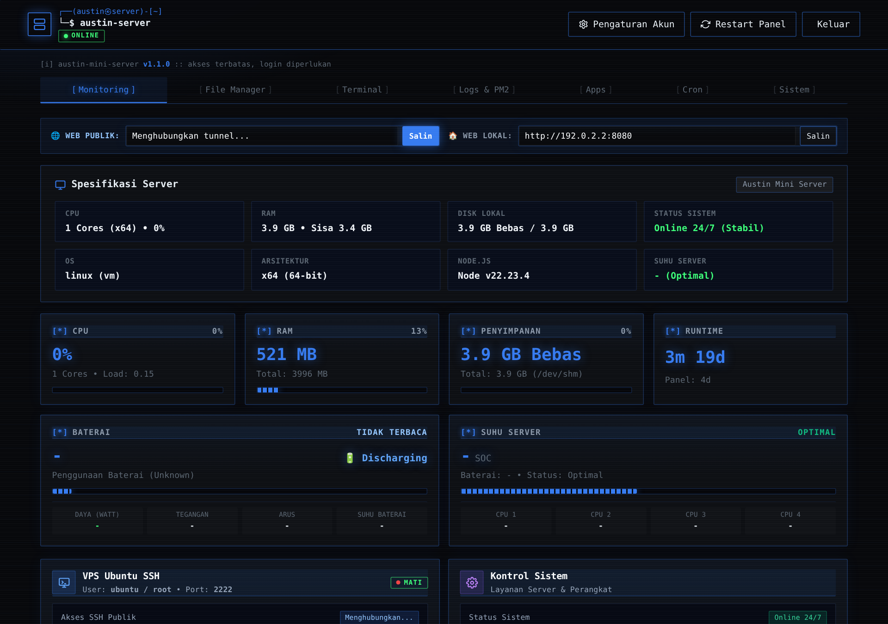
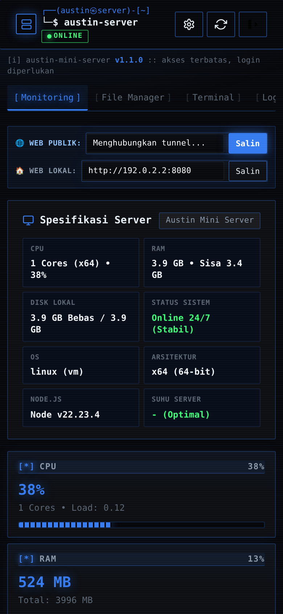
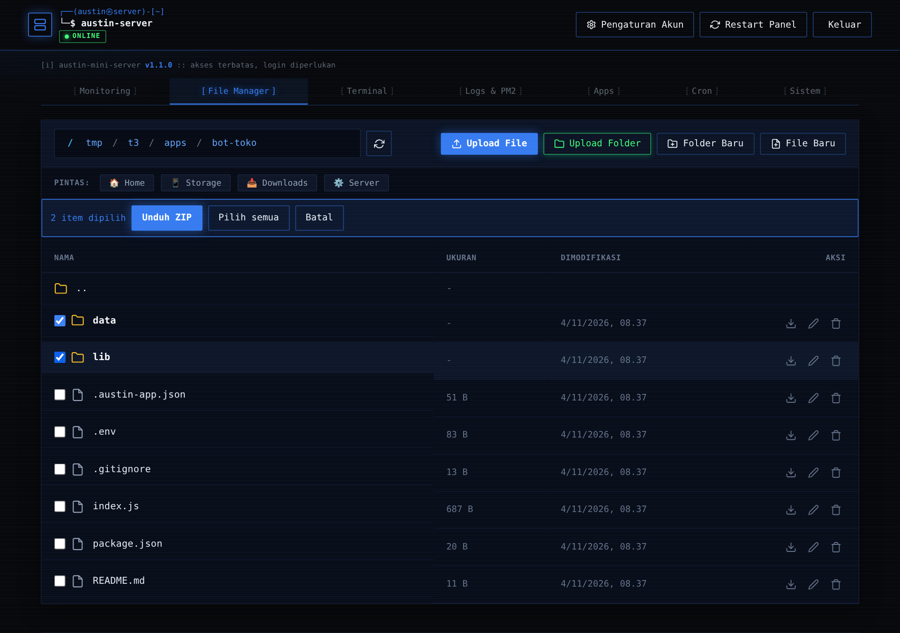
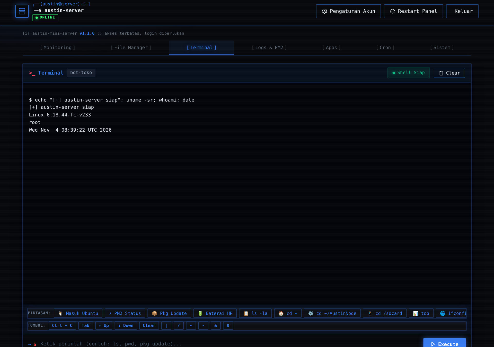
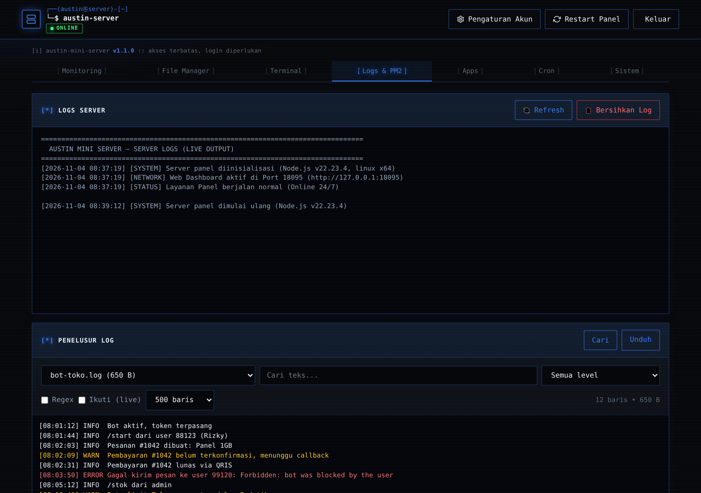

# Austin Mini Server

**HP Android lama di laci? Jadikan server.** Austin Mini Server mengubah ponsel Android (tanpa root) menjadi server kecil yang bisa dipantau dan dikelola dari browser: ada dashboard, terminal web, file manager, pengelola app, dan Ubuntu VPS lengkap dengan SSH. Tampilannya bertema terminal ala Kali Linux: gelap, monospace, aksen biru.

Versi **1.0.0** · dibuat oleh **Austin** · lisensi MIT

---

## Isi paket

| Bagian | Fungsinya |
| --- | --- |
| **Dashboard web** (port `8080`) | Pusat kendali. Dibuka dari HP, tablet, atau laptop. |
| **Ubuntu VPS** (SSH port `2222`) | Ubuntu asli di dalam Android lewat PRoot, tanpa root. |
| **Cloudflare Tunnel** | Link HTTPS publik otomatis, tanpa IP publik atau port forwarding. |
| **PM2** | Menjaga app Node.js tetap hidup dan otomatis menyala lagi kalau crash. |

Tampilan panel:

| Monitoring | Tampilan HP |
| :---: | :---: |
|  |  |

| File Manager | Terminal | Logs & PM2 |
| :---: | :---: | :---: |
|  |  |  |

---

## Mulai cepat

Butuh waktu sekitar 10–20 menit, tergantung koneksi internet dan kecepatan HP.

**1. Pasang Termux**

Ambil dari [F-Droid](https://f-droid.org/packages/com.termux/) atau GitHub Releases resmi. Jangan dari Play Store, versinya sudah usang dan repositorinya tidak jalan.

| Android | Termux yang dipakai |
| --- | --- |
| 5.0 – 6.0 | v0.119.0-beta.3 varian `apt-android-5` |
| 7.0 – 14+ | Versi terbaru dari F-Droid / GitHub |

**2. Jalankan installer**

```bash
pkg update -y && pkg install git -y
git clone https://github.com/austinoffc/AustinServer.git
cd AustinServer
bash install.sh
```

Installer akan mengaktifkan wake-lock, memasang paket yang diperlukan (Node.js, PM2, Python, OpenSSH, FFmpeg, PRoot, dan lainnya), mengunduh Ubuntu sesuai arsitektur CPU, menyiapkan SSH di port 2222, lalu menyalakan server.

**3. Buka panel**

| Dari mana | Alamat |
| --- | --- |
| Wi-Fi yang sama | `http://<IP-HP>:8080` |
| Dari mana saja | Link `https://….trycloudflare.com` yang tampil di terminal saat server menyala |

Login awal: `admin` / `admin123`.

> **Segera ganti password.** Kredensial awal itu sama di semua instalasi. Buka menu **Akun** di pojok kanan atas dan ubah username serta password sebelum server kamu buka ke internet. Hal yang sama berlaku untuk password SSH Ubuntu (`ubuntu123`); ubah dengan `passwd` di dalam VPS.

Tips: pasang juga **Termux:Boot** (opsional) supaya server menyala sendiri setelah HP restart.

---

## Tur panel

Panel punya tujuh tab. Tiga tab terakhir (Apps, Cron, Sistem) baru hadir di versi 1.0.0.

### Monitoring
Angka CPU, RAM, disk, baterai, uptime, dan suhu diperbarui langsung. Berguna untuk memastikan HP tidak kepanasan saat jalan 24 jam.

### File Manager
Jelajahi folder Termux dan penyimpanan internal. Bisa upload, buat, ganti nama, hapus, ekstrak ZIP, dan unduh.

Yang baru:
- **Editor multi-tab.** Klik file teks untuk membukanya. Ada warna sintaks, cari & ganti (mendukung regex), nomor baris, auto-indent, dan `Ctrl+S` untuk simpan. Titik oranye di tab berarti ada perubahan yang belum tersimpan.
- **Unduh banyak file.** Centang beberapa file atau folder, lalu tekan *Unduh ZIP*.

### Terminal
Konsol Bash di browser dengan output streaming, riwayat perintah (panah atas/bawah), dan `Ctrl+C`.

### Logs & PM2
Kelola proses PM2 (start, stop, restart, lihat log) dan baca log panel.

Yang baru, **Penelusur Log**: pilih sumber log, ketik kata kunci, saring berdasarkan level (error, warning, info, debug), atau pakai regex. Centang *Ikuti (live)* untuk melihat baris baru saat muncul, mirip `tail -f`.

### Apps
Tempat mengelola aplikasi Node.js (atau Python/shell) milikmu. Lihat bagian berikutnya.

### Cron
Jadwalkan perintah berulang dengan format cron biasa, misalnya `*/10 * * * *` atau `@daily`. Tersedia preset, tombol *Jalankan*, dan output terakhir tiap job. Zona waktu yang dipakai mengikuti server dan ditampilkan di bagian atas tab.

### Sistem
- **Pembaruan**: cek versi terbaru dan update dengan satu tombol.
- **Tunnel & Domain**: lihat atau ganti URL tunnel, dan susun config `cloudflared` untuk domain sendiri.
- **Port terbuka**: siapa yang memakai port berapa.
- **Aplikasi (PWA)**: pasang panel di layar utama HP.

---

## Deploy app pertama

Contoh: kamu punya bot Telegram dalam bentuk folder `bot-toko`.

1. Zip folder itu menjadi `bot-toko.zip`. Tidak masalah kalau isinya terbungkus satu folder; panel akan meratakannya.
2. Buka tab **Apps**. Isi *Nama app* (`bot-toko`). *File start* dan *Port* boleh dikosongkan.
3. Pilih ZIP-nya lalu tekan **Deploy**. Kamu akan melihat prosesnya langsung: ekstrak, `npm install`, lalu start lewat PM2.
4. Tekan **.env** pada app tersebut untuk mengisi token dan variabel rahasia. Pilih *Simpan & Restart*.

Beberapa hal yang perlu diketahui:
- File start dipilih otomatis dengan urutan: isi kolom *File start*, `scripts.start` di `package.json`, lalu `main`, lalu tebakan seperti `index.js`, `server.js`, `app.js`.
- Isi `.env` dan nilai port otomatis diteruskan ke proses sebagai variabel lingkungan, jadi app tidak wajib memakai `dotenv`.
- Mau memperbarui app? Deploy lagi dengan nama yang sama dan centang *Timpa*. File `.env` tetap aman.
- Tombol **Backup** pada app membuat arsip tanpa `node_modules`. Di bagian *Backup & Restore* kamu juga bisa menyalakan backup harian otomatis dan menentukan berapa salinan yang disimpan.

---

## Masuk ke Ubuntu VPS

Dari Termux di HP server:

```bash
austin-vps      # atau cukup: ubuntu
```

Dari komputer lain:

```bash
ssh root@<IP-HP> -p 2222
```

Kalau memakai klien SSH berbasis aplikasi (Termius, JuiceSSH, PuTTY), isi host dengan IP HP, port `2222`, user `root` atau `ubuntu`.

---

## Perintah yang tersedia

Di Termux:

| Perintah | Fungsi |
| --- | --- |
| `austin-server` | Menyalakan atau me-restart panel dan VPS |
| `austin-stop` | Mematikan semuanya |
| `austin-status` | Cek apakah port 8080 dan 2222 hidup |
| `austin-vps` | Masuk ke Ubuntu |
| `austin-update` | Memperbarui ke versi terbaru |
| `termux-fix` | Memperbaiki dpkg Termux yang macet |

Pilihan lain lewat skrip: `bash ~/AustinServer/start.sh [status|stop|restart]`.

Di dalam Ubuntu:

| Perintah | Fungsi |
| --- | --- |
| `panel-status` | Ringkasan CPU, RAM, suhu, baterai |
| `panel-restart` | Meminta panel restart |
| `vps-install <paket>` | `apt install` dengan perbaikan otomatis bila gagal |
| `vps-fix` | Membersihkan lock apt/dpkg |

---

## Memperbarui server

Cara termudah: tab **Sistem → Cek Update → Update Sekarang**. Cara lain, di Termux:

```bash
austin-update
```

Update tidak menyentuh `apps/`, `backups/`, jadwal cron, maupun password panel.

Mengecek versi: `cat VERSION`.

### Kalau kamu yang merilis versi baru

1. Ubah isi file `VERSION` (misalnya dari `1.0.0` jadi `1.0.1`).
2. Tambahkan catatan di bagian atas `CHANGELOG.md`.
3. Push ke branch `main` di `austinoffc/AustinServer`.

Panel akan menampilkan "Versi baru tersedia" begitu angka di repo lebih besar dari yang terpasang.

---

## Struktur folder

```text
AustinServer/
├── install.sh          Installer otomatis
├── start.sh            Menyalakan / menghentikan layanan
├── update.sh           Skrip pembaruan
├── VERSION             Nomor versi
├── CHANGELOG.md        Riwayat perubahan
├── panel/
│   ├── server.js       Server utama dashboard
│   ├── extras.js       Modul Apps, Backup, Cron, Log, Port, Update
│   └── public/         Antarmuka web (index.html, theme-kali.css, editor.js, extras.js, PWA)
├── apps/               App hasil deploy (tidak ikut git)
├── backups/            Arsip backup (tidak ikut git)
└── scripts/            Skrip pendukung Ubuntu
```

---

## Spesifikasi dan kebutuhan

| | Minimal | Disarankan |
| --- | --- | --- |
| Android | 5.0 | 7.0 – 14+ |
| CPU | ARM32 / x86 | ARM64 / x86_64 |
| RAM | 512 MB | 1 – 2 GB |
| Ruang kosong | 1,5 GB | 3 GB+ |
| Root | Tidak perlu | Tidak perlu |

Perkiraan pemakaian saat idle: panel sekitar 25–45 MB RAM, VPS Ubuntu sekitar 25–40 MB. Instalasi lengkap memakan 2–3,5 GB penyimpanan. Angka ini tergantung perangkat; jalankan `pkg clean` dan `vps-fix` kalau ingin membersihkan sisa cache.

---

## Menjaga HP tetap sehat saat jalan 24 jam

- Di pengaturan baterai Android, set Termux ke **Tanpa batasan** dan matikan penghemat daya ekstrem.
- Di pengaturan Wi-Fi lanjutan, pilih **Tetap menyala saat tidur**.
- Lepas casing, arahkan kipas kecil ke punggung HP, dan pakai charger yang stabil. Pantau suhu di tab Monitoring.

---

## Kredit

Dikembangkan dan dirawat oleh **Austin**. Berlisensi MIT, silakan dipakai dan dimodifikasi.
